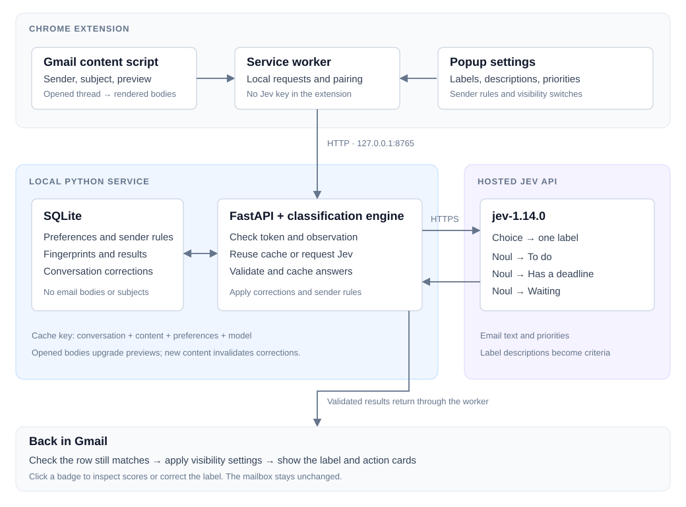

# Jev Email Labels

Labels Gmail conversations and groups messages that need attention. Runs as a Chrome extension with a local Python service.

- Important, Routine, Spam, and custom labels with editable descriptions.
- A switch to hide each label from the inbox.
- Sender rules and corrections for individual conversations.
- To do, Has a deadline, and Waiting views.

Email text is sent to the hosted Jev API. The extension reads visible Gmail content and leaves the mailbox unchanged.

## How it works



The service sends one Choice question for the label and three Noul questions for actions. Cached results are reused when the email and preferences have not changed. Corrections and sender rules take precedence over Jev’s selected label.

[Architecture](docs/architecture.md) · [Privacy](docs/privacy.md) · [Evaluation](docs/evaluation.md)

## Setup

Requires Chrome, Node.js 24, Python 3.12+, [uv](https://docs.astral.sh/uv/), and a [TypeSafe API key](https://console.typesafe.ai/).

```sh
git clone https://github.com/vishnugamini/email-jev-labeller.git
cd email-jev-labeller
npm ci
npm run build
uv sync --locked
cp .env.example .env
chmod 600 .env
```

1. Add your key to `.env` as `TYPESAFE_API_KEY=...`.
2. Open `chrome://extensions`, enable **Developer mode**, and select **Load unpacked** → `extension/dist`.
3. Copy the extension ID and start the service:

```sh
uv run --env-file .env python -m service --extension-id YOUR_EXTENSION_ID
```

4. Open the extension popup. Paste the pairing token printed in Terminal and select **Pair**.
5. Turn on **Classify visible emails** and open Gmail.

Keep the terminal running. The service uses `127.0.0.1:8765`. Stop it with **Ctrl+C**.

## Labels

Click a badge to see probabilities, confidence, and correction controls. Jev selects one label per conversation; the app displays that selection without a confidence threshold.

Select **Add label**, enter a name and description, then **Save changes**. Up to 12 custom labels are supported. Descriptions are sent to Jev as the category definitions. Visibility switches hide badges without changing which labels Jev can select.

Corrections override sender rules. Exact sender addresses take precedence over domain rules; domain rules do not include subdomains. Corrections apply to the current conversation content and are cleared when that content changes. Removing a custom label also removes its rules and corrections.

## Actions

| View | Shows |
| --- | --- |
| To do | Messages needing your reply or action. |
| Has a deadline | Outstanding actions with an explicit deadline. |
| Waiting | Conversations where someone owes you a response or deliverable. |

A conversation can appear in more than one view. **Open** takes you to the thread. **Done** hides the card; **Undo** restores it. These controls do not change Gmail.

The panel covers up to 200 conversations scanned in the current tab. Waiting requires an opened thread. Reloading, pausing, or switching accounts clears the cards and completion state.

## Development

```sh
uv sync --locked --group dev
uv run python -m pytest service/tests -q
npm test
npm run build
```

Browser tests use synthetic Gmail content and a mock provider:

```sh
PLAYWRIGHT_BROWSERS_PATH=.cache/browsers npx playwright-core install chromium
npm run test:browser
```

Build source and extension ZIPs with `python scripts/package_release.py`. Files and checksums are written to `release/`. The extension ZIP still requires the local service.

## Troubleshooting

| Problem | Fix |
| --- | --- |
| Port 8765 is in use | Stop the old service with Ctrl+C. Ctrl+Z leaves it running in a suspended state. |
| Service unavailable | Start the service and leave its terminal open. |
| Pairing fails | Check the extension ID and pairing token. |
| API key rejected | Update `.env` and restart the service. |
| Old badges after an update | Rebuild, reload the extension, then refresh Gmail. |

## Limits

Unopened messages provide only previews. Opened threads add rendered bodies and expanded replies. Attachments and unloaded replies are not read. Gmail’s DOM can change, and real-inbox accuracy has not been measured on a held-out dataset.

This version requires a local service. It does not include hosted accounts, background mailbox scanning, reminders, or Gmail API access.
