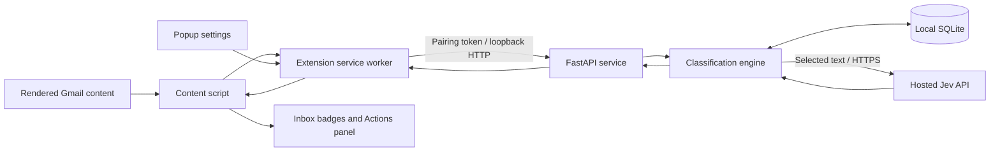

# Architecture

## Data flow

The extension bundles its JavaScript for Manifest V3. The worker performs loopback requests because the Gmail content script does not directly handle the API key or service pairing token. The API key remains in the service environment.

## Components

| Component | Responsibility |
| --- | --- |
| `extension/src/extract.ts` | Extract account, conversation, sender, subject, preview, visible metadata, and rendered messages. |
| `extension/src/content.ts` | Observe Gmail navigation and DOM updates, schedule visible rows, reject stale responses, render badges and correction controls. |
| `extension/src/action-panel.ts` | Maintain the current tab’s scanned conversations and independent action views. |
| `extension/src/popup.ts` | Edit descriptions, custom labels, priorities, sender rules, visibility, pairing, and activity. |
| `extension/src/background.ts` | Validate message senders and routes, retrieve trusted extension settings, call the local service. |
| `service/app.py` | Pairing, origin checks, request limits, preferences, cache, overrides, health, and activity routes. |
| `service/engine.py` | Normalize observations, apply rules/corrections, cache results, orchestrate Jev, validate responses. |
| `service/models.py` | Validate request fields and custom-label definitions. |
| `service/actions.py` | Define and interpret independent Noul action questions. |

## Observation lifecycle

1. A visible Gmail row produces a normalized observation and content revision. An opened thread adds only currently rendered bodies and expanded replies.
2. DOM mutations are debounced. Row identity, account, revision, mailbox, and message content are checked before a response attaches to a row. Recycled rows cannot inherit another conversation’s result.
3. The worker forwards observations to the paired local service.
4. The engine checks revision, content fingerprint, preference/policy version, model, and evidence level. Matching results are reused. Opened-body results can serve later preview observations of the same unchanged conversation and mailbox.
5. Uncached observations reach Jev. Results are validated before caching or display. Errors produce an actionable error state, never an invented label.
6. Manual corrections and sender rules replace the category shown to the user. Action scores remain independent.

No message is automatically opened, no reply expanded, and no attachment fetched. Subjects alone are not used to establish reliable thread identity. Unknown identities use session-scoped storage.

## Jev requests

The model is pinned to `jev-1.14.0`. Each conversation receives:

- One **Choice** question: default descriptions plus custom labels form `criteria`.
- Three **Noul** questions: To do, Has a deadline, and Waiting.

The structured state includes priorities, sender fields, subject, preview, metadata, mailbox, evidence level, truncation, and rendered message history. Message direction and chronological positions distinguish requests to the user from requests the user sent to someone else. Email content is treated as untrusted evidence.

The selected Choice is displayed directly. Probabilities and confidence are retained for inspection, not treated as proof of correctness. Noul scores enter action views at 0.80 or higher; scores at or below 0.20 are negative; intermediate values remain uncertain. Waiting additionally requires opened-body evidence and reliable identity.

Default behavior is individual requests, up to four concurrent provider calls within a classification operation. An engine lock serializes overlapping operations to preserve cache/body-upgrade ordering. Experimental groups of four or eight share one state; every question explicitly identifies its target email. Groups exceeding 24,000 UTF-8 bytes are split. Questions cannot consume each other’s answers.

Text is limited to 16,000 characters per conversation, prioritizing subject, sender, and newest incoming content before recent context. The SDK uses bounded retries; the engine imposes a 24-second overall deadline per provider call. Output validation rejects unknown choices, invalid distributions, non-finite values, and malformed action scores.

## Labels and precedence

Default IDs are `important`, `routine`, and `spam`. Up to 12 custom labels have a stable `custom_…` ID, unique display name, and description. Names can change without changing the ID. Custom names and descriptions appear in Choice criteria; response validation uses the exact configured ID set.

Precedence is conversation correction, exact address rule, exact domain rule, then model selection. New content invalidates corrections. Deleting a custom label clears corrections targeting it; the popup removes its sender rules, while the API rejects rules referencing unknown labels. Preference changes invalidate model cache entries.

Visibility is a browser-local display preference. Hidden categories remain available to Jev and do not change action membership. Turning a category off does not prevent its email text from being submitted.

## Storage

| Location | Data |
| --- | --- |
| `.local/state.sqlite3` → `settings` | Preferences, descriptions, custom labels, priorities, and sender rules. |
| `.local/state.sqlite3` → `records` | Hashed conversation keys, revisions, fingerprints, preference version, evidence level, model results, corrections. |
| In-memory SQLite | Results and corrections for observations without reliable identity, scoped to tab session. |
| `.local/pairing-token` | Random persistent service pairing secret. |
| `chrome.storage.local` | Pairing token, pause state, request grouping, custom-label display metadata, hidden categories. |
| Content-script memory | Up to 200 scanned conversation cards, previews, and temporary Done/Undo state. |
| Service memory | Last 50 request activity summaries. |

The service does not persist email subjects or bodies. Fingerprints and stable revisions allow cache reuse without storing source text. There is no automatic cache expiry or size eviction; users can explicitly clear results. SQLite is suitable for this single-user local service; no cloud database is required.

## Local API

All routes require the paired extension origin and bearer token, including health.

| Method | Route | Purpose |
| --- | --- | --- |
| GET | `/health` | Service and API-key configuration status. |
| POST | `/classify` | Classify a list of observations. |
| GET / PUT | `/preferences` | Read or replace validated preferences. |
| PUT / DELETE | `/overrides` | Correct or reset a conversation category. |
| DELETE | `/cache` | Clear model results while retaining preferences and corrections. |
| GET | `/activity` | Recent model, latency, usage, and sanitized error summaries. |

## Trust boundaries

The service binds only to `127.0.0.1`. CORS permits the configured extension origin. Requests also require the random token. Worker requests without an Origin header must include the matching extension-origin header and token; a conflicting actual Origin is rejected. The claim header alone is not authentication.

Request bodies are capped at 1 MB. Pydantic bounds field sizes and rejects unknown fields. API errors avoid echoing submitted email text. SDK logging is disabled. Gmail page content and model responses are untrusted; UI text is rendered without interpreting it as HTML.

Loopback HTTP is for the local prototype. A public backend must use HTTPS, verified user authentication, per-user storage, and server-enforced quotas; the shared local pairing mechanism is not a multi-user authentication design.

## Public version boundary

The extraction and classification modules can be retained while replacing the local transport. Required future work includes authenticated sessions, account isolation, quota enforcement, deletion/retention policies, provider review, and release operations. An optional Gmail API adapter would be a separate OAuth integration and is not part of this implementation.
