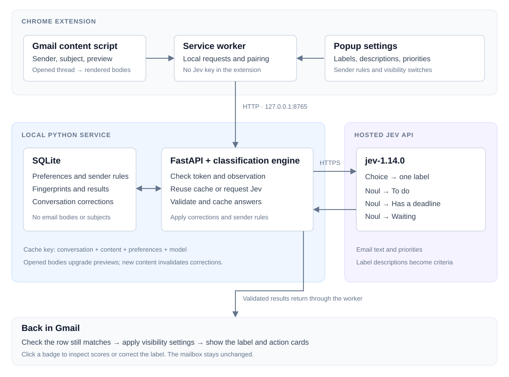
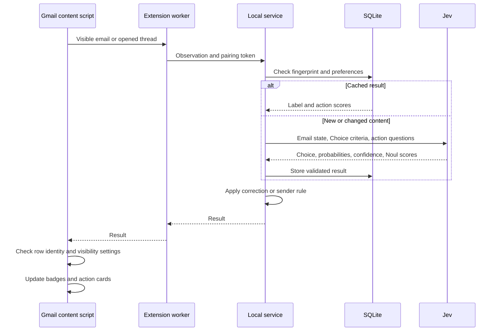

# Architecture

## Request flow

1. The content script reads visible rows: sender, subject, preview, and metadata. Opening a thread adds rendered message bodies and expanded replies.
2. The service worker forwards observations to FastAPI on `127.0.0.1:8765`, using the pairing token.
3. The engine checks the conversation revision, content fingerprint, preferences, model, and evidence level. Matching results come from SQLite.
4. On a cache miss, the service sends the email state to `jev-1.14.0`: one Choice question for the category and three Noul questions for actions.
5. The service validates and caches the answers, then applies any category correction or sender rule.
6. The content script checks that the row still represents the same account, conversation, and content before showing badges and action cards.

## Classification

Default categories are Important, Routine, and Spam. Custom labels have a stable ID, display name, and description. `Preferences.criteria()` combines the default descriptions with custom categories for the Choice request.

The selected category is displayed directly. Precedence is **correction → address rule → domain rule → Jev**. Corrections do not become training examples. Category changes do not affect action scores.

Action scores of at least 0.80 enter the corresponding view; scores of 0.20 or below are negative. Values in between remain uncertain. Waiting also requires opened-body evidence and reliable account/thread identity.

Requests normally contain one conversation, with up to four provider calls running concurrently inside a classification operation. An engine lock serializes overlapping operations. Experimental groups of four or eight share one state; each question names its target email. Groups larger than 24,000 UTF-8 bytes are split.

Submitted text is capped at 16,000 characters per conversation. Subject, sender, and newest incoming messages receive priority. The service preserves message order and direction, retries through the SDK, and limits each provider call to 24 seconds.

## Storage

| Location | Contents |
| --- | --- |
| `.local/state.sqlite3` | Preferences, custom labels, sender rules, hashed conversation keys, fingerprints, results, and corrections. |
| In-memory SQLite | Session-scoped results when account or thread identity is unreliable. |
| `.local/pairing-token` | Service pairing token. |
| `chrome.storage.local` | Pairing token, pause state, grouping, custom-label names, and visibility settings. |
| Tab memory | Scanned conversation previews and Done/Undo state. |
| Service memory | Last 50 request activity summaries. |

The service does not persist email bodies or subjects. An opened-body result can serve a later preview of the same unchanged conversation. New content invalidates corrections; preference changes invalidate model results. The cache has no automatic expiry or size limit.

## Modules

| File | Responsibility |
| --- | --- |
| `extension/src/extract.ts` | Gmail content and conversation identity. |
| `extension/src/content.ts` | Scanning, row checks, badges, and corrections. |
| `extension/src/action-panel.ts` | Action cards and Done/Undo state. |
| `extension/src/popup.ts` | Settings, custom labels, pairing, and activity. |
| `extension/src/background.ts` | Worker messages and local HTTP requests. |
| `service/app.py` | HTTP routes, pairing, and request limits. |
| `service/engine.py` | Jev calls, cache, rules, and response validation. |
| `service/models.py` | Observation, preference, and label validation. |
| `service/actions.py` | Action questions and score handling. |

## API and access

| Method | Route | Purpose |
| --- | --- | --- |
| GET | `/health` | Service and key status. |
| POST | `/classify` | Classify observations. |
| GET / PUT | `/preferences` | Read or replace preferences. |
| PUT / DELETE | `/overrides` | Correct or reset a category. |
| DELETE | `/cache` | Clear results, retaining preferences and corrections. |
| GET | `/activity` | Request timing, model, usage, and errors. |

Every route requires the pairing token and configured extension origin. Worker requests without an Origin header also send the matching extension-origin header. Request bodies are capped at 1 MB; field sizes and provider responses are validated. Errors do not echo email text, and SDK logging is disabled.

The API key stays in the service environment. Gmail content is treated as data, and UI text is inserted without interpreting it as HTML.
